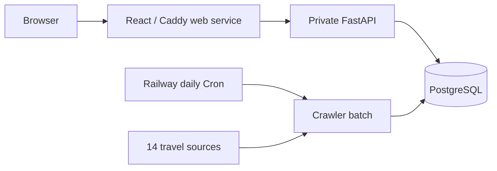

# Crowl — implementation plan

> Crowl = Crow + Crawl. It is a read-only, single-owner travel-fare monitor for weekend trips from the Paris metropolitan area to cities in the Schengen Area.
>
> This document began as the implementation plan. The repository now contains
> a runnable implementation using the supplied 150-city catalog; see
> [docs/implementation-status.md](docs/implementation-status.md) for the exact
> boundary between completed local work and external inputs still required.

### Current implementation boundary

This plan contains both implemented behavior and the production target. In the
current implementation:

- The local Compose stack, read-only API, crawler batch platform, city/status
  UI, history, and monitoring use the supplied 150-city catalog. Compose does
  not seed fare observations.
- The map uses MapLibre with an attributed OpenFreeMap geographic basemap,
  city markers, pan/zoom, clustering, keyboard controls, and an equivalent
  list. The dedicated Schengen boundary/mask described below is pending.
- Composition pairs complete outbound and return components across sources and
  modes and accepts provider-supplied multi-leg itineraries. Arbitrary
  within-direction cross-source leg chaining is pending.
- All 14 requested provider adapter slots and status rows exist. **FlixBus is
  enabled for direct Paris Bercy Seine routes to Amsterdam Sloterdijk and
  Brussels Gare du Midi.** The other 13 providers are disabled. The guarded
  2026-11-21 activation published one real €45.96 displayed-fare observation
  for the 2026-11-27 weekend.
- Railway infrastructure definitions are versioned and type-check. Applying
  them to an owner project and verifying scheduled production runs are pending.
- `data/crowl-cities-150.json` is the canonical editorial catalog. Operational
  terminal mappings remain incomplete and are maintained separately.

## 1. Product scope

Crowl will collect and retain daily fare snapshots for eligible weekend trips by air, train, and bus. It will make those snapshots explorable through:

1. A Schengen map for comparing destinations for a selected weekend.
2. A city page for understanding the latest observed journeys and how prices change as a weekend approaches.
3. A read-only source-status page for seeing whether each extractor is healthy, empty, blocked, stale, or failing.

The first release is a single-owner data model with no accounts and no editing in the UI. The site can be shared with friends, but cities, visited/wishlist status, attributes, photos, terminals, and source settings remain version-controlled.

### In scope for v1

- 150 monitored Schengen cities supplied through JSON.
- Paris-area departure and return terminals: CDG, ORY, BVA, Paris passenger rail/bus terminals, and Massy.
- A rolling six-calendar-month weekend search horizon.
- Flights, trains, buses, provider-supplied connections, cross-source
  outbound/return pairs, and mixed-mode round trips. Arbitrary cross-source
  chaining of legs within one direction remains a planned extension.
- One daily fixed batch and permanent daily best-price history by transport mode.
- Exact terminal and connection details for every displayed journey.
- All 14 requested source slots, with infeasible sources explicitly marked unsupported or blocked.
- Docker Compose for local development and a Railway production deployment.

### Deliberately out of scope for v1

- User accounts, personalized collections, or UI editing.
- Origins outside the Paris metropolitan area.
- Destinations outside the configured Schengen scope. The initial strict-path setting also excludes non-Schengen intermediate stops and can be relaxed later without a schema change.
- Door-to-door pricing or journey duration from Palaiseau.
- Destination-airport/station transfer time and cost.
- Paid luggage, paid discount cards, subscriptions, loyalty benefits, or seat upgrades.
- Public-holiday or long-weekend rules.
- Email alerts and a dedicated “best options” page; the schema will leave clean extension points for both.
- Circumventing CAPTCHAs, authentication, rate limits, bot defenses, or other access controls.

## 2. Confirmed rules and explicit assumptions

| Area | Decision |
|---|---|
| Ownership | Single-owner configuration; read-only UI; shareable by URL; no accounts. |
| Geography | Destinations are strictly Schengen, using a country/territory set versioned from an official source. Initial assumption: `strict_schengen_path=true`, so intermediate terminals must also be in scope. |
| Home | Palaiseau is highlighted on the map as the home-base marker. It is not used in fare or duration calculations. |
| Paris terminals | CDG, ORY, BVA, all curated Paris passenger rail/bus terminals, and Massy. Outbound and return may use different Paris terminals. |
| Weekend start | The first outbound departure must be at or after Friday 19:00 in `Europe/Paris`. |
| Weekend end | The final return arrival at an allowed Paris-area terminal must be no later than Monday 07:00 in `Europe/Paris`. |
| Minimum stay | At least 12 hours between final arrival at the destination and first departure back. |
| Duration | At most 12 hours elapsed terminal-to-terminal in each direction, including connections and connection waiting time. |
| Modes | Flight, train, bus, and mixed. Direct and connected journeys are valid. |
| Composition | Outbound and return can use different sources, operators, terminals, and modes. Provider-supplied connections and safe independently booked connections can be represented. The current implementation pairs complete directional components; arbitrary within-direction cross-source leg chaining is pending. |
| Destination | Exactly one destination metro area per trip; connection cities do not count as destinations. |
| Nearby terminals | Nearby airports/stations/stops may map to a city. Their city-transfer time and cost are excluded, but the exact terminal is always shown. |
| Passenger | One traveler, age 22, student eligibility enabled where genuinely available. Use the normal adult fare when no generally eligible student/youth fare exists. |
| Fare | Cheapest complete round-trip fare observed as available during that daily batch, normalized to EUR, with unavoidable taxes and fees and only the smallest included personal item. FlixBus is the explicit v1 exception: Crowl may use the exact fare displayed on its public result card while excluding a later online service fee, provided the UI labels it `Displayed fare — service fees may apply`. |
| Entitlements | Do not use a fare requiring a paid card, subscription, membership, or loyalty status that is not configured. |
| History | Store the daily best valid price for every city × weekend × mode, not every source’s full permanent history. Keep the winning journey details. |
| Schedule | One fixed daily batch. Initial configurable default: `02:00 UTC`. |
| Public holidays | No special behavior. |
| Photos | Manually curated, licensed, and attributed; approved remote Wikimedia assets are allowed. |

“Best price for each model” is interpreted as “best price for each mode.” The persisted mode buckets are `flight`, `train`, `bus`, and `mixed`; the `all` price is derived as their minimum.

The unspecified second section of the city page is provisionally the latest-observed itinerary panel: exact tickets, operators, terminals, connections, duration, source, observation time, and booking link when available for a selected weekend.

Historical charts cannot be truthfully backfilled. They begin accumulating after the first production batch. The default city chart will show up to 26 past and 26 future weekends, with controls to inspect all retained history.

## 3. Product success criteria

A first release is useful when a visitor can:

- Select any weekend in the next six calendar months and immediately compare the cheapest eligible destinations.
- Distinguish visited, wishlist, unmonitored, missing-price, and incomplete-data states without relying on color alone.
- Open a monitored city and understand its attributes, typical observed journey times, price history, and latest observed best journey.
- See exact departure, arrival, and connection terminals; Crowl must never hide Beauvais, a remote destination airport, or a terminal change behind a city label.
- Tell when a price was observed and whether source coverage was complete, partial, failed, or stale.
- Inspect all requested sources on a read-only status page and distinguish a valid empty result from a broken extractor.
- Run the same stack locally with Compose and deploy it predictably to Railway.

## 4. Frontend experience

### 4.1 Routes

| Route | Purpose |
|---|---|
| `/` | Schengen map, weekend selector, mode filter, legend, and accessible city list. |
| `/cities/:slug` | City profile, typical durations, price heatmap, and latest-observed journey details. |
| `/status` | Read-only daily batch and extractor monitoring. |
| `*` | Minimal not-found page linking back to the map. |

Shareable query parameters preserve important state:

```text
/?weekend=2027-01-08&mode=all&lat=48.9&lon=8.2&zoom=4
/cities/vienna?weekend=2027-01-08&mode=train
/status?source=ryanair
```

Browser back/forward must restore the weekend, mode, map position, and selected city.

### 4.2 Schengen map

The current implementation uses MapLibre with a configurable, properly attributed OpenFreeMap tile style. The initial camera fits the Schengen Area, including Iceland, Norway, and Switzerland. City markers provide pan/zoom, clustering, keyboard controls, state colors, tooltips, and a synchronized accessible list. Palaiseau is a distinct home marker labeled “Palaiseau / Paris” and is excluded from fare colors. A muted non-Schengen mask or dedicated Schengen boundary remains to make the legal geographic scope explicit.

The map has two states:

1. **Collection view:** no weekend selected. Visited cities use pastel green; wishlist cities use pastel blue.
2. **Weekend-price view:** a weekend is selected. Marker fill uses a low-to-high fare gradient while the marker border/badge continues to carry visited or wishlist status.

The weekend control displays the actual rule, for example:

```text
Fri 8 Jan after 19:00 → Mon 11 Jan by 07:00
```

Mode filters are `Any`, `Flight`, `Train`, `Bus`, and `Mixed`. `Any` is the cheapest valid mode bucket. A visible disclosure says:

> Round trip for one traveler, age 22/student where supported; mandatory fees included except for the explicitly labelled FlixBus displayed-fare policy; no extra baggage. Travel from Palaiseau to the Paris departure terminal and from the arrival terminal to the destination city is excluded. Transfers inside the displayed itinerary are included where priced.

#### Marker states

| State | Fill | Border or badge |
|---|---|---|
| Visited, collection view | Pastel green | Check icon and text in tooltip. |
| Wishlist, collection view | Pastel blue | Star icon and text in tooltip. |
| Price available | Fixed low-to-high fare gradient | Visited/wishlist badge remains visible; partial/stale overlays can coexist with the price. |
| Valid crawl, no journey | White with an em dash | Text reason such as “No eligible result.” |
| Timetable not released | Muted calendar pattern | “Not on sale yet.” |
| No trustworthy fare because collection failed | Neutral center | Failure badge and explicit reason. |
| Unmonitored | No Crowl marker | Underlying map remains visible. |
| Palaiseau | Dark crow/home marker with halo | “Home base” label. |

Availability, execution coverage, source scope, and freshness are orthogonal. For example, a real €80 fare may be both partial and stale: retain its price fill and add a pattern/badge rather than replacing the price. Use a colorblind-safe sequential price palette that is distinct from visited, success, and warning colors.

Use fixed, configurable map bands so a color means the same thing between weekends. Initial half-open bands are `<€50`, `€50–<€100`, `€100–<€175`, `€175–<€250`, and `€250+`; revise them after real-data distribution is known. A zero price is never a normal fare. The legend always shows euro values.

Hover, keyboard focus, or a mobile bottom sheet shows:

- City and country.
- Visited/wishlist status.
- Categories and all configured 1–5 attributes.
- Editorial summary.
- Selected-weekend price and winning mode.
- Exact origin and destination terminals.
- Observation time and coverage/freshness state.

Clicking or activating “View city” opens the city route. Cluster overlapping markers at continental zoom; activating a cluster zooms or spiderfies it and never invents an aggregate fare. A synchronized searchable list/table is the primary accessible map control: alphabetical/status order in collection view, lowest-price order in price view, and explicit Name/Price/Status sort controls.

### 4.3 City page

The city page contains:

1. A manually curated hero image, visible credit where required, city name, summary, visit status, categories, and attribute indicators.
2. Typical terminal-to-terminal duration cards for flight, train, and bus.
3. The historical price heatmap.
4. A persistent latest-observed/winning itinerary panel for the selected weekend or heatmap cell.

“Typical duration” is the rolling median across all valid observed offers for that city and mode, using compact daily duration aggregates captured before losing offers expire. When enough observations exist, also show the interquartile range and sample count. Before enough data exists, show “Not enough data,” never an invented value.

Preserve the map’s weekend and mode when navigating. When the route is opened directly, default to the next eligible weekend and `Any`, clearly showing that choice. Selecting a historical heatmap cell switches the panel into labeled historical-inspection mode; a “Back to latest observation” action restores the selected upcoming weekend.

Every journey names its actual terminals, for example:

```text
Paris Gare de Lyon → Milano Centrale
Paris Orly → Rome Fiumicino
Massy TGV → Amsterdam Centraal
```

#### Heatmap definition

- **Row:** trip weekend, identified by its Friday date.
- **Column:** lead days between the observation date and the winning itinerary’s actual outbound departure date.
- **Cell:** lowest eligible round-trip fare observed for the city, weekend, lead day, and selected mode.
- **Columns:** the actual maximum produced by the rolling six-calendar-month horizon down to 0, with useful labels near 180, 150, 120, 90, 60, 30, 14, 7, and 0.
- **Rows:** future and past sections, with 26 of each by default.

Calculate `lead_days` as the calendar-day difference between `observed_on` and the winning first outbound departure converted to `Europe/Paris`; do not use a fixed 24-hour division.

Cell states must distinguish:

- A valid observed fare.
- A successful search with no eligible itinerary.
- A timetable not yet released.
- Partial coverage or source failure.
- A date that had not happened yet.
- A date for which no crawl was scheduled.

Use a stable city-and-mode-specific robust color scale calculated over a documented rolling horizon, initially the 10th–90th percentiles, so scrolling or filtering does not change the same fare’s color. The API returns the scale breakpoints and the legend displays actual euro boundaries. Hover/focus/select reveals the price, observation date, lead days, travel window, modes, times, durations, terminals, sources, and independent availability/coverage/freshness states.

The itinerary panel presents every separately purchased component with subtotal, seller/source, operator, exact terminals, connection time, protection state, and its own booking link when available. Unprotected/self-transfer or separate-ticket combinations receive a prominent missed-connection and price-change warning. All segment times appear in each terminal’s local time with date, timezone abbreviation, and clear overnight/day-change markers; the UI explains that weekend eligibility is evaluated in `Europe/Paris`.

A historical cell proves only what was observed then. Label it non-live, never present its link as currently bookable, and warn that all prices and availability must be rechecked at the provider. On narrow screens the grid scrolls horizontally with sticky weekend labels. The alternative table is paginated, and the visual grid uses roving arrow-key navigation rather than thousands of tab stops.

### 4.4 Source-status page

`/status` is informational only. It contains no retry, enable, disable, or configuration controls.

The summary shows stored batch status and its user-facing label:

- Latest/current batch state: `queued`, `running`, `succeeded`, `partial`, `failed`, or `abandoned`, mapped to labels such as Healthy or Degraded.
- Start, heartbeat, and completion times.
- Enabled/applicable source count versus all known applicable requested sources.
- Execution coverage across expected cells for the enabled/applicable sources.
- Latest trustworthy price observation.
- Next expected batch.

Each of the 14 source rows shows:

- Name, supported transport mode, enabled state, and disabled reason.
- Configured strategy and connector/parser version.
- Current state, last attempt, last valid success, runtime, and consecutive failures.
- Expected, attempted, successful, empty, and result-bearing search counts.
- Logical cell coverage, physical request count, source-scope ratio, and data freshness.
- A sanitized diagnostic summary.

Never expose credentials, cookies, raw pages, private endpoints, stack traces, or Railway variables.

### 4.5 Visual system

Use the supplied reference image as a visual direction rather than copying its subject matter:

- Warm off-white page background and white surfaces.
- Strong dark 2 px outlines.
- Rounded rectangular cards, inputs, chips, and buttons.
- Bold, friendly serif headings with a clean sans-serif UI font.
- Pastel blue active states, pastel green success, soft rose warnings, and restrained amber accents.
- Minimal shadows, generous whitespace, and simple line icons.

Initial tokens:

```text
background  #FAF9F6
surface     #FFFFFF
ink         #242421
border      #30302D
blue        #65B8E8
green       #D7F3CD
rose        #F6D4D7
amber       #F3D37B
radius-sm   10px
radius-md   16px
border      2px
```

Candidate self-hosted fonts are Fraunces or Source Serif for headings and Inter for body/UI text. Do not reproduce the flame/star counters from the reference.

Target WCAG 2.2 AA. Use dark ink on pastel surfaces and automate contrast checks. Because MapLibre/ECharts canvas marks are not inherently accessible, use DOM button markers where practical and treat the synchronized list as the primary map control. Provide focus equivalents for hover, 44 px touch targets, visible focus, reduced-motion support, textual state labels, image alt text, and non-map/non-heatmap table alternatives. Also require a skip link, route-aware page titles, focus movement after navigation, focus trapping/restoration in mobile sheets, and an `aria-live` result-count update after filters change.

## 5. City and terminal configuration

Editorial city data and operational terminal mappings must be separate. City attributes will change with the supplied list; airports, stations, provider aliases, and route coverage change on a different schedule.

### 5.1 City JSON contract

`data/crowl-cities-150.json` follows this shape. Categories and attributes are definitions, not hard-coded frontend fields.

```json
{
  "schemaVersion": 1,
  "origin": {
    "id": "palaiseau-paris-fr",
    "name": "Palaiseau / Paris",
    "timezone": "Europe/Paris",
    "coordinates": { "lat": 48.7145, "lon": 2.2457 }
  },
  "categoryDefinitions": [
    { "id": "culture", "label": "Culture" },
    { "id": "food", "label": "Food" },
    { "id": "nightlife", "label": "Nightlife" },
    { "id": "winter", "label": "Winter" },
    { "id": "adventure", "label": "Adventure" },
    { "id": "beach", "label": "Beach" },
    { "id": "nature", "label": "Nature" }
  ],
  "attributeDefinitions": [
    { "id": "expense", "label": "Expensive", "min": 1, "max": 5, "lowLabel": "Affordable", "highLabel": "Very expensive" },
    { "id": "culture", "label": "Culture", "min": 1, "max": 5, "lowLabel": "Limited", "highLabel": "Exceptional" },
    { "id": "nightlife", "label": "Nightlife", "min": 1, "max": 5, "lowLabel": "Quiet", "highLabel": "Very active" },
    { "id": "nature", "label": "Nature", "min": 1, "max": 5, "lowLabel": "Limited", "highLabel": "Exceptional" },
    { "id": "food", "label": "Food", "min": 1, "max": 5, "lowLabel": "Limited", "highLabel": "Exceptional" }
  ],
  "cities": [
    {
      "id": "amsterdam-nl",
      "slug": "amsterdam",
      "name": "Amsterdam",
      "country": { "code": "NL", "name": "Netherlands" },
      "timezone": "Europe/Amsterdam",
      "coordinates": { "lat": 52.3676, "lon": 4.9041 },
      "status": { "visited": true, "wishlist": false },
      "categories": ["culture", "nightlife"],
      "summary": "Canals, compact neighborhoods, museums, and easy rail access.",
      "attributes": { "expense": 4, "culture": 5, "nightlife": 4, "nature": 2, "food": 4 },
      "photo": {
        "asset": "/images/cities/_placeholder.webp",
        "alt": "Placeholder image for Amsterdam",
        "creator": null,
        "sourceUrl": null,
        "license": null,
        "curationStatus": "pending",
        "objectPosition": "50% 50%"
      }
    },
    {
      "id": "lisbon-pt",
      "slug": "lisbon",
      "name": "Lisbon",
      "country": { "code": "PT", "name": "Portugal" },
      "timezone": "Europe/Lisbon",
      "coordinates": { "lat": 38.7223, "lon": -9.1393 },
      "status": { "visited": false, "wishlist": true },
      "categories": ["culture", "food", "beach"],
      "summary": "Hillside neighborhoods, Atlantic light, food, and nearby beaches.",
      "attributes": { "expense": 3, "culture": 5, "nightlife": 4, "nature": 3, "food": 5 },
      "photo": {
        "asset": "/images/cities/_placeholder.webp",
        "alt": "Placeholder image for Lisbon",
        "creator": null,
        "sourceUrl": null,
        "license": null,
        "curationStatus": "pending",
        "objectPosition": "50% 50%"
      }
    },
    {
      "id": "vienna-at",
      "slug": "vienna",
      "name": "Vienna",
      "country": { "code": "AT", "name": "Austria" },
      "timezone": "Europe/Vienna",
      "coordinates": { "lat": 48.2082, "lon": 16.3738 },
      "status": { "visited": false, "wishlist": true },
      "categories": ["culture", "food", "winter"],
      "summary": "Imperial architecture, museums, cafés, and winter markets.",
      "attributes": { "expense": 4, "culture": 5, "nightlife": 3, "nature": 3, "food": 4 },
      "photo": {
        "asset": "/images/cities/_placeholder.webp",
        "alt": "Placeholder image for Vienna",
        "creator": null,
        "sourceUrl": null,
        "license": null,
        "curationStatus": "pending",
        "objectPosition": "50% 50%"
      }
    },
    {
      "id": "reykjavik-is",
      "slug": "reykjavik",
      "name": "Reykjavík",
      "country": { "code": "IS", "name": "Iceland" },
      "timezone": "Atlantic/Reykjavik",
      "coordinates": { "lat": 64.1466, "lon": -21.9426 },
      "status": { "visited": false, "wishlist": true },
      "categories": ["winter", "adventure", "nature"],
      "summary": "A compact base for geothermal landscapes and winter travel.",
      "attributes": { "expense": 5, "culture": 3, "nightlife": 3, "nature": 5, "food": 3 },
      "photo": {
        "asset": "/images/cities/_placeholder.webp",
        "alt": "Placeholder image for Reykjavík",
        "creator": null,
        "sourceUrl": null,
        "license": null,
        "curationStatus": "pending",
        "objectPosition": "50% 50%"
      }
    }
  ]
}
```

`status.visited` and `status.wishlist` are independent, so a future city can carry both badges without a migration. Cities absent from the monitored JSON are unmonitored and receive no Crowl marker.

Use `data/cities.schema.json` for shape, types, required fields, and numeric ranges. A separate semantic validator checks unique IDs/slugs, real IANA timezones, category/attribute references, definition coverage, Schengen eligibility, and photo provenance. Development permits `photo.curationStatus="pending"`; production requires complete provenance plus a stable curated asset URL or a checked-in local asset. Removing a city marks it inactive in PostgreSQL instead of deleting its history.

### 5.2 Terminal configuration

`data/terminals.json` owns:

- Canonical airport, rail, and bus terminal IDs.
- Coordinates and IANA timezone.
- Many-to-many city links and nearby-city relationship type.
- A separate Paris/Massy origin allowlist.
- Schengen-scope validation.
- Transfer edges, conservative minimum times, and known/free/paid cost rules where independent connections are allowed.

Keep source-specific codes and aliases in `source_terminal_aliases`, not on the canonical terminal itself. A terminal can serve several monitored cities through `city_terminal_links`.

The implementation must enumerate the actual Paris/Massy allowlist; “all Paris terminals” cannot remain an implicit string. The UI always uses the canonical terminal label from this registry.

### 5.3 Photo curation

For each real city, manually select one properly licensed hero image and retain:

- Original source URL, creator, and license.
- Required attribution wording.
- Meaningful alt text.
- Crop focal point.
- Local original and optimized asset paths.

Store optimized responsive AVIF/WebP derivatives locally rather than hotlinking. A production validation step rejects placeholders and missing provenance. Roughly 150 optimized images are acceptable in the first repository; move them to object storage/CDN later only if repository or build size becomes problematic.

## 6. Architecture

### 6.1 Service flow



Use one monorepo with three independently deployable services and one shared Python package:

```text
/
├── services/
│   ├── web/                 # React + TypeScript + Vite; Caddy production image
│   ├── api/                 # FastAPI read-only query API
│   └── crawler/             # One-shot daily batch; Playwright only in this image
├── packages/
│   └── crowl-core/          # Rules, models, normalization, composition, settings
├── data/
│   ├── crowl-cities-150.json
│   ├── cities.schema.json
│   ├── terminals.json
│   └── sources.yaml
├── migrations/              # Alembic
├── tests/
│   └── fixtures/sources/    # Sanitized, versioned response fixtures
├── compose.yaml
├── .env.example
└── plan.md
```

### 6.2 Technology choices

| Concern | Choice |
|---|---|
| Web | React, TypeScript, Vite, React Router, TanStack Query. |
| Map | MapLibre with a configurable attributed OpenFreeMap style; dedicated Schengen boundary/mask pending. |
| Heatmap | Apache ECharts with an accessible table fallback. |
| API | FastAPI, Pydantic, SQLAlchemy 2, Alembic. |
| Database | PostgreSQL, using UTC `timestamptz`, IANA timezones, JSONB only for flexible editorial attributes, and integer minor units for money. |
| Crawling | Public HTML only: direct HTTPS plus HTML/embedded-JSON parsing when the complete result is in the response, or ordinary Playwright rendering for client-side pages. |
| Scheduling | Railway Cron starts one batch process daily; no scheduler runs inside a long-lived container. |
| Queue/restarts | PostgreSQL crawl-task ledger, advisory lock, and `FOR UPDATE SKIP LOCKED`; no Redis or Celery initially. |
| Web serving | Caddy serves the built React app and reverse-proxies same-origin `/api/*` to the private API. |
| Testing | Pytest, Vitest/Testing Library, Playwright E2E, PostgreSQL integration tests, and source fixtures. |

Pin exact stable versions when implementation begins and update them deliberately. Do not put Chromium or Playwright dependencies in the API image.

### 6.3 Responsibility boundaries

- `web`: renders only read models; no data mutation controls.
- `api`: exposes versioned `GET` endpoints and health checks. It never performs source extraction.
- `crawler`: discovers coverage, searches, normalizes, composes, validates, snapshots, and writes health state, then exits.
- `crowl-core`: owns all canonical trip rules, money/time handling, schemas, SQLAlchemy models, and deterministic winner selection shared by API and crawler.
- `postgres`: is the only canonical operational/history store.

## 7. PostgreSQL model

Use immutable rule/profile versions so an old price remains interpretable after configuration changes.

### 7.1 Catalog and rules

| Table | Purpose |
|---|---|
| `cities` | Stable slug, name, country, timezone, coordinates, independent visited/wishlist flags, categories, attributes, summary, active flag. |
| `city_photos` | Asset path, alt text, creator, source URL, license, focal point, primary flag. |
| `terminals` | Canonical airport/rail/bus terminal, coordinates, timezone, and Schengen/path eligibility. |
| `city_terminal_links` | Many-to-many terminal/city relationships such as primary, nearby-airport, or nearby-station. |
| `origin_terminals` | Versioned Paris/Massy departure/return allowlist, independent of destination-city links. |
| `source_terminal_aliases` | Provider-specific terminal IDs/codes mapped to canonical terminals, with provenance/effective dates. |
| `terminal_transfers` | Allowed connection edge, conservative duration, known/free/paid cost rule, and evidence/source. |
| `sources` | Slug, name, supported modes, configured strategy, enabled/disabled state and reason. |
| `source_route_coverage` | Known source terminal/market/date coverage, provenance, effective dates, and discovery timestamp for manifest pruning. |
| `search_profiles` | Passenger age/student status, baggage assumptions, currency, entitlement settings, and immutable config hash. |
| `travel_windows` | Friday identity, lower/upper bounds, minimum stay, maximum direction duration, retained past/future state. |
| `rule_versions` | Immutable Schengen scope, terminal config, trip rules, and application/config hash referenced by each batch. |
| `fx_rates` | ECB currency-to-EUR daily reference rate and timestamp; weekends use the latest prior published business-day rate. |

### 7.2 Batch and extractor health

| Table | Purpose |
|---|---|
| `crawl_runs` | One scheduled batch per Paris calendar date: manifest/config version, status, start/end/heartbeat/published timestamps, release version, counts. |
| `extractor_runs` | One source within a batch: query counts, offers, duration, state, last response/success, sanitized diagnostic. |
| `crawl_coverage_cells` | Logical expected source × city × weekend × direction cells, applicability, completion, and result/empty state. |
| `connector_requests` | Physical adapter requests keyed by `(crawl_run_id, source_id, request_fingerprint)`; one request may satisfy many cells and one cell may need several requests. Stores attempts/outcome for 30–90 days. |
| `health_events` | Canary failure, suspicious result collapse, stale data, parser/schema drift, stuck batch, and recovery events. |

Keep these dimensions separate instead of overloading one status field:

| Dimension | Canonical values |
|---|---|
| Batch | `queued`, `running`, `succeeded`, `partial`, `failed`, `abandoned` |
| Extractor run | `pending`, `running`, `succeeded`, `partial`, `failed`, `blocked`, `quarantined`, `disabled` |
| Search outcome | The request outcomes defined in section 10. |
| Fare availability | `available`, `no_valid_option`, `not_on_sale`, `sold_out`, `unknown_due_failure` |
| Execution coverage | `complete`, `partial`, `failed`, `not_applicable` |
| Freshness | `fresh`, `stale` relative to a configurable age threshold |

The UI maps stored states to friendly labels such as Healthy or Degraded; it does not store those labels as another competing state machine.

### 7.3 Staging and permanent history

| Table | Purpose |
|---|---|
| `staged_offers` | Current-run normalized one-way or atomic round-trip offers, seller/source, pricing semantics, raw/EUR amount, deeplink, collected time, expiry. |
| `staged_legs` | Direction, order, mode, operator/service, exact terminals, local/UTC times, protected/unprotected connection. |
| `fare_snapshots` | One logical daily cell for observation date × city × weekend × profile × mode, with a pointer to its current published revision. |
| `fare_snapshot_revisions` | Immutable published value/state revision for a logical snapshot cell, including its winning batch and `published_at`. |
| `snapshot_bookings` | Immutable independently purchased tickets for one snapshot revision: component prices, sources, links, fare names, and student use. |
| `snapshot_legs` | Immutable winning outbound/return leg sequence and exact terminals/times for one snapshot revision. |
| `duration_histograms_daily` | Mergeable 15-minute duration-bin counts across deduplicated valid staged offers by date, city, and mode before staging expires. |

`fare_snapshot_revisions` stores:

- Best normalized EUR total. Each booking component retains its original amount/currency and FX rate in `snapshot_bookings`.
- Mode bucket, outbound/return boundaries, each direction’s duration, stay duration, and transfer count.
- Availability: `available`, `no_valid_option`, `not_on_sale`, `sold_out`, or `unknown_due_failure`.
- Execution coverage: `complete`, `partial`, or `failed` among enabled/applicable sources.
- Source-scope ratio: enabled/applicable requested sources divided by all known applicable requested sources.
- Winning batch, rule version, and search profile.

Aggregate availability deterministically across sources:

1. Any complete valid winner produces `available`.
2. With no winner, any failed/unknown required coverage cell produces `unknown_due_failure`.
3. `sold_out` or `not_on_sale` is emitted only when successful applicable coverage supports that conclusion consistently.
4. Otherwise, completed successful coverage with no eligible candidate produces `no_valid_option`.

Enforce uniqueness on:

```text
(observed_on, profile_id, destination_city_id, travel_window_id, mode_bucket)
```

`observed_on` is the scheduled batch’s calendar date in `Europe/Paris`; `observed_at` retains the precise collection time. An interrupted batch resumes unfinished requests. If a trustworthy request is deliberately repeated, retain its attempts and select the lowest complete, non-quarantined fare actually observed that day together with its matching booking/leg rows. Never apply a blind numeric `LEAST` across incoherent or quarantined results. Publish a new immutable revision and its children atomically, then update the logical cell’s current-revision pointer in the same transaction. APIs read current finalized revisions; older revisions remain for audit. Partial coverage may expose a real price, but it must be labeled partial.

Freshness is not persisted on immutable history. The API/current-state view derives `fresh` or `stale` from `observed_at`, the latest expected batch time, and a configurable threshold.

Retain permanent snapshots and winning details indefinitely. Keep losing staged offers for 24–72 hours, then delete them. Never delete or invalidate historical prices because a later extractor failed.

At 150 cities × 26 weekends × 4 persisted mode buckets, the upper bound is about 15,600 snapshot states per day. Start with a regular indexed table; add monthly partitioning only after volume/query-plan tests justify it, designing child foreign keys to include the partition key. Index:

- `(destination_city_id, travel_window_id, mode_bucket, observed_on)` for heatmaps.
- `(travel_window_id, observed_on)` on logical cells plus `(fare_snapshot_id, total_price_eur_cents)` on revisions.
- `(travel_window_id, mode_bucket, total_price_eur_cents)` on the atomically refreshed `latest_fares` read table for map queries.
- `(crawl_run_id)` on `fare_snapshot_revisions` for publication/revision lookup.
- `(crawl_run_id, source_id, state)` on `extractor_runs` and `(crawl_run_id, source_id, outcome)` on `connector_requests` for monitoring.

Create read models/views for latest fares, current extractor health, coverage/scope ratios, and rolling duration statistics by city/mode. Rolling p25/p50/p75 values come from merged fixed-bin daily histograms; do not average or merge percentile values directly.

## 8. Journey normalization and composition

### 8.1 Canonical offer model

Each normalized offer includes:

- Provider offer ID where available, source, seller, operator, observation time, expiry, and an allowlisted canonical booking URL stripped of session/auth/checkout tokens.
- Original currency/amount, EUR cents, conversion rate/date, fare name, and price completeness: `complete`, `estimated`, or `unknown`.
- Passenger eligibility, mandatory fees, included baggage, and whether a student/youth fare was applied.
- Pricing semantics: `one_way`, `round_trip_only`, or `composable`.
- One or more journeys and ordered segments.
- Local and UTC departure/arrival, exact terminal IDs, mode, carrier/operator, service number, and elapsed duration.
- Protected or unprotected connection status.

A provider’s bundled round-trip price remains atomic unless reliable directional prices are exposed. Never divide it in half to manufacture a one-way price.

Only `complete` prices may normally compete for Crowl’s advertised best fare. Estimated or unknown totals can be retained for diagnostics but are not published as winners. The sole v1 exception is an exact FlixBus public result-card fare: it may compete with `estimated` completeness and `mandatory_fees_included = false`, but every API/UI presentation must disclose `Displayed fare — service fees may apply` and it must never be described as a final checkout total.

### 8.2 Identity and deduplication

- `itinerary_key`: hash of canonical terminal sequence, UTC times, operators, service numbers, and segment order; excludes price.
- `offer_key`: itinerary plus seller/source, fare family, passenger/baggage assumptions, and pricing semantics.
- `observation_key`: batch + search request + source + offer key.

If several sellers expose the same journey, preserve provenance and choose the cheapest eligible seller. On an exact price tie, prefer a direct-operator booking, then shorter elapsed duration, fewer transfers, and finally a deterministic key.

### 8.3 Validation

All extractors normalize first; only `crowl-core` decides validity. It enforces:

1. Allowed Paris-area start and end terminals.
2. Friday 19:00 lower bound and Monday 07:00 hard arrival deadline in `Europe/Paris`.
3. Twelve-hour maximum elapsed time in each direction, including connections.
4. Twelve-hour minimum stay at the destination.
5. One destination metro area and, while the initial strict-path assumption is enabled, a Schengen-only terminal sequence.
6. Passenger/fare/fee/baggage assumptions.
7. Complete, timezone-aware segment order and non-negative connection times.
8. Offered as bookable at observation time rather than a teaser/from price when the source distinguishes them.

Test boundary instants exactly and across European daylight-saving transitions.

### 8.4 Mixed and connected trips

Pair any compatible outbound and return offers regardless of source, operator, terminal, or mode. A trip is `mixed` whenever the distinct modes across all of its legs contain more than one value, including an intermodal itinerary sold as one booking.

The current implementation pairs complete outbound and return components and
accepts provider-supplied multi-leg itineraries; it does not yet synthesize one
direction from arbitrary legs published by different sources. The graph-based
within-direction composition described below remains pending.

Accept provider-supplied protected connections as protected bundles. The
configured transfer-edge/time/cost rules below apply to independent
connections composed by Crowl, not to a provider's protected through-ticket.
Crowl-generated independent connections are marked `unprotected_transfer` and
are valid only when:

- A configured minimum connection rule exists.
- Any terminal change has a trustworthy transfer edge and enough time.
- A paid intermediate transfer has a complete price that is added to the total; an unknown required transfer cost makes the candidate invalid.
- The complete direction remains within 12 hours.
- All component prices are independently bookable and complete.

Use a time-aware graph and Pareto pruning by total price, arrival time, elapsed duration, and changes. Disallow cycles and repeated terminals. If no trustworthy transfer rule exists, do not infer feasibility.

Destination-side airport/station transfer time and cost remain excluded. That exclusion must never be used to ignore an intermediate connection transfer.

## 9. Extractor platform

### 9.1 Shared connector contract

Every source adapter implements a versioned interface:

- `metadata()` — source, modes, strategy, version, markets, sale horizon, and enabled state.
- `discover_coverage()` — terminals/routes and currently sellable date range where supported.
- `canary()` — a small set of known productive searches before the full batch.
- `search(request)` — typed offers, a valid empty reason, or a structured failure.
- `close()` — releases HTTP/browser resources.

`SearchRequest` includes a deterministic request fingerprint, batch/query IDs, `one_way` or `round_trip` search kind, direction where applicable, separate outbound/return windows, canonical terminal sets, UTC instants plus IANA timezones, passenger profile, price/baggage assumptions, and maximum duration. This supports both provider-bundled round trips and directional offers for mixed composition.

Every accepted public-page fare must explicitly identify one adult passenger,
include mandatory taxes and fees, and confirm that no unconfigured paid card,
subscription, membership, or loyalty entitlement is required. Missing or
contradictory evidence is parser failure, not a valid fare. FlixBus is the
explicit v1 exception for mandatory online service fees only: its exact public
result-card fare may be accepted without proving a later service fee, and must
be stored and displayed as an estimated displayed fare. Passenger identity,
exact itinerary, currency, card amount, and no-paid-entitlement checks remain
mandatory.

`ConnectorResult` includes status, retryability, safe diagnostic code, expected/completed counts, normalized offers, parser version, observation time, and a response/schema fingerprint. It must not include secrets, cookies, or full sensitive payloads in logs.

### 9.2 Extraction-strategy rule

Verify the provider's current access terms and the live fare response before
enabling a source. Documented official search interfaces may be used when
the provider permits the planned usage.

1. `http_structured` for an official, documented fare-search interface, with
   its published limits and required permissions.
2. `http_html` when a normal HTTPS response contains the complete fare in HTML
   or literal JSON embedded in that HTML.
3. `playwright` when the same ordinary public page needs client-side rendering;
   parse only the resulting DOM and embedded page data.
4. `disabled` when the exact fare cannot be extracted reliably with the
   available access.

Ordinary cookie-consent controls may be accepted. Do not log in, intercept
private network calls, or evade CAPTCHAs, `403`, persistent `429`, rate limits,
or bot defenses with stealth plugins, proxy/identity rotation, or burner
accounts. Record the typed state and skip the connector.

### 9.3 Requested-source matrix

All 14 adapters and status rows belong to the first release. FlixBus is
enabled for two verified routes. Enabling another source requires a successful
live fare test with exact pricing, terminal aliases, route coverage, and
permitted access.

| Source | Mode | Provisional primary strategy | Enablement gate |
|---|---|---|---|
| Ryanair | Flight | `playwright` public booking-page HTML/embedded JSON | Verify stable complete live fare markup, aliases, and coverage; otherwise skip. |
| easyJet | Flight | `playwright` public booking-page HTML/embedded JSON | Same gate; otherwise skip. |
| Transavia | Flight | `playwright` public booking-page HTML/embedded JSON | Same gate; otherwise skip. |
| Wizz Air | Flight | `playwright` public booking-page HTML/embedded JSON | Same gate; challenge or unstable markup stays skipped. |
| Vueling | Flight | `playwright` public booking-page HTML/embedded JSON | Same gate; otherwise skip. |
| Volotea | Flight | `playwright` public booking-page HTML/embedded JSON | Same gate; challenge or unstable markup stays skipped. |
| FlixBus | Bus | `playwright` public rendered search-card DOM | Enabled for direct Bercy Seine–Sloterdijk and Bercy Seine–Brussels Gare du Midi cards. Store the exact one-adult displayed fare with a service-fee disclosure. An exact-trip booking link is optional. |
| BlaBlaCar Bus | Bus | `playwright` public bus search-page JSON-LD | Same gate; rideshare remains excluded. |
| Itabus | Bus | `playwright` public search-page JSON-LD | Same gate; otherwise skip. |
| Alsa | Bus | `playwright` public search-page JSON-LD | Same gate; otherwise skip. |
| OUIGO | Train | `playwright` public search-page HTML/JSON-LD | Verify ordinary accessible results, aliases, and coverage; otherwise skip. |
| SNCF Connect | Train | `playwright` public search-page HTML/JSON-LD | Current challenge behavior is not bypassed; keep skipped. |
| Trenitalia France | Train | `playwright` public search-page HTML/JSON-LD | Verify stable complete live fare markup, aliases, and coverage; otherwise skip. |
| Eurostar | Train | `playwright` public search-page HTML/JSON-LD | Verify Schengen-only coverage and stable markup; London remains excluded. |

If a later verification shows that a complete result is available in the
initial public HTTPS response, change that source to `http_html`; the parser
contract remains the same. Before enabling any adapter, record its reviewed
public-page basis, conservative rate, supported markets, booking horizon,
attribution/linking requirements, and kill switch in `data/sources.yaml`.

## 10. Daily batch and safeguards

A naïve batch is approximately `150 cities × 26 weekends × 14 sources = 54,600` source/route/weekend checks before alternate terminals. Do not issue that blindly. Reduce work using source route coverage, terminal mappings, sale horizons, and date-range/fare-calendar calls.

One Railway Cron invocation starts the complete fixed batch. Independent sources may run concurrently inside it with conservative global and per-source limits.

Report two denominators:

- **Execution coverage:** completed logical cells divided by expected cells for sources that are enabled and applicable to that route/window.
- **Source scope:** enabled/applicable requested sources divided by all known applicable requested sources, including disabled or inaccessible ones.

“Complete” means complete execution among enabled/applicable sources; the UI must still say, for example, “complete across 5 of 11 applicable requested sources.”

### Batch lifecycle

1. Acquire a PostgreSQL advisory lock and create or resume the date’s `crawl_run`.
2. Generate Friday-to-Monday windows through six calendar months and store an immutable manifest of logical coverage cells.
3. Prune unsupported routes and dates outside a provider’s booking horizon.
4. Run source canaries. Quarantine a source before full work if all canaries show blocking, parser drift, or unexpected emptiness.
5. Claim restartable physical connector requests, search with bounded concurrency/timeouts/capped retry, map each response to its covered logical cells, and honor `Retry-After`.
6. Normalize into staged offers/legs and validate schemas, times, prices, and completeness.
7. Compare result volume and coverage with recent source baselines; quarantine suspicious collapse.
8. Exclude quarantined offers, deduplicate, and compose valid outbound/return trips.
9. Select the cheapest valid result for each city × weekend × mode, using deterministic tie-breakers. Enforce a configurable maximum observation-time skew for cross-source components (initially two hours) and revalidate the top independently booked/mixed candidates before publication where the source permits it.
10. Atomically publish fare snapshots and coverage facts, refresh read models, finalize health state, and expire old staging/search detail.
11. Mark the batch `succeeded`, `partial`, or `failed`, release resources, and exit.

Set a configurable 20-hour outer watchdog, comfortably before the following day’s Cron. At the deadline, stop claiming work, cancel remaining tasks as `cancelled_deadline`, terminate Playwright child processes, publish only trustworthy completed cells as a partial batch, release resources, and exit. The API detects a stale heartbeat or missed run independently because Railway deployment health checks are not continuous monitoring.

A source failure does not discard other sources’ valid results. A completed batch with source errors records `partial` and exits normally; a non-zero process exit is reserved for batch-level failures such as an unavailable database or inability to create the ledger.

### Search outcomes

- `success_results`
- `success_empty`
- `not_on_sale`
- `no_service`
- `sold_out` only where the upstream source explicitly distinguishes it
- `partial_success`
- `blocked`
- `captcha_challenge`
- `rate_limited`
- `timeout`
- `upstream_error`
- `parse_schema_error`
- `configuration_error`
- `cancelled_deadline`
- `skipped_disabled`
- `skipped_unsupported_route`

An empty result is not itself a failure. Before publishing a source run, compare manifest completion, recent result baseline, city/weekend coverage, required-field success, and canary behavior. If a normally productive source yields zero across the batch or coverage collapses below its configured threshold, mark `suspicious_empty`, quarantine that source run, and do not let it erase or masquerade as valid data.

The API may show the last valid price during a degraded batch only with a prominent `as_of` time and separate freshness and coverage badges. It must never turn extractor failure into `€0` or “no route.”

## 11. FastAPI read surface

Version the API from the start:

```text
GET /api/v1/meta
GET /api/v1/weekends
GET /api/v1/cities
GET /api/v1/map-prices?weekend=YYYY-MM-DD&mode=all
GET /api/v1/cities/{slug}
GET /api/v1/cities/{slug}/price-history?mode=all
GET /api/v1/cities/{slug}/journeys?weekend=YYYY-MM-DD&mode=all
GET /api/v1/batches/latest
GET /api/v1/extractors
GET /api/v1/extractors/{source}/runs
GET /health/live
GET /health/ready
```

Every price view includes observation time, availability, execution coverage, source-scope ratio, freshness, exact endpoints, passenger/rule version, returned price-scale breakpoints where relevant, and a compact winning itinerary. Heatmap cells include either a price or an explicit missing-state reason. The frontend must not infer crawler health from a nullable amount.

The API has no mutation endpoints in v1. Give its production database role `SELECT` access only.

## 12. Local development and Railway deployment

### 12.1 Docker Compose

`compose.yaml` is the local development contract:

- `web`: React development server or production Caddy profile.
- `api`: FastAPI with reload in development.
- `crawler`: short-lived command service, enabled through a Compose profile.
- `postgres`: local PostgreSQL with a named volume.

Run the crawler locally on demand, for example through `docker compose run --rm crawler ...`. Do not run a permanent in-container scheduler.

### 12.2 Railway topology

Railway deploys Compose components as individual services rather than one permanent Compose stack. Use one Railway project/European region with:

1. A public `web` service serving React and reverse-proxying `/api` over private networking.
2. A private `api` service.
3. A private one-shot `crawler` Cron service.
4. A Railway PostgreSQL service, single-node initially.

Configure distinct Dockerfile paths and watch paths. API and crawler use the repository root as build context because both install `crowl-core`. Run `alembic upgrade head` through exactly one pre-deploy path using the migration-role URL, an advisory-lock timeout, and an explicit platform timeout—not the API’s read-only credentials and not every replica.

Because Railway services deploy independently, migrations must follow backward-compatible expand/contract steps: deploy additive schema first, deploy compatible API/crawler code, backfill if needed, and remove old columns only in a later release. API and crawler startup/readiness checks verify the expected Alembic revision and refuse incompatible code/schema combinations.

Initial crawler schedule:

```cron
0 2 * * *
```

Railway Cron is UTC and skips a new occurrence if the previous execution is still active, so the crawler must heartbeat, close resources, and exit. Set its platform restart policy to never; controlled retries happen in the PostgreSQL ledger.

Use separate credentials where practical:

- API role: read only.
- Crawler role: catalog reads and operational/history writes.
- Migration role: schema ownership.

Store public-page configuration in Railway variables and never configure login
credentials, cookies, or persistent browser state. Keep all services and
PostgreSQL in the same European region, pin Playwright/browser versions, and
cap browser contexts. Configure deployment health checks, while recognizing
that they only gate deployments and do not continuously monitor crawler
freshness. Enable scheduled PostgreSQL backups and test a restore procedure
before treating them as protection for permanent history.

Relevant Railway documentation:

- [Dockerfiles and Docker Compose import](https://docs.railway.com/builds/dockerfiles)
- [Monorepo deployment](https://docs.railway.com/deployments/monorepo)
- [Cron jobs](https://docs.railway.com/cron-jobs)
- [Private networking](https://docs.railway.com/networking/private-networking/how-it-works)
- [Deployment health checks](https://docs.railway.com/deployments/healthchecks)
- [Pre-deploy commands](https://docs.railway.com/deployments/pre-deploy-command)
- [Volume backups](https://docs.railway.com/volumes/backups)

## 13. Security, compliance, and data hygiene

- Review and record each provider’s current terms, allowed access method, rate limits, and attribution requirements before enabling it.
- Use ordinary public-page HTML or documented official fare-search interfaces
  with the required permissions. Never use intercepted private browser calls.
- Use Playwright only for normal public-page rendering; accepting an ordinary
  cookie-consent control is allowed, but do not bypass challenges or access
  controls.
- Stop a connector on CAPTCHA, persistent `403`/`429`, or authentication challenge and expose the reason on `/status`.
- Centralize per-source rate/concurrency limits and a configuration kill switch.
- Never commit provider tokens, cookies, Railway variables, or production dumps.
- Sanitize logs and diagnostics. Store short-lived parser artifacts only when they contain no credentials or personal data.
- Store only allowlisted canonical booking links with transient/session parameters removed, retain upstream expiry where known, and never describe a historical link as live. Validate outbound URLs and use safe browser attributes. A booking link is optional for FlixBus displayed-card fares; absence of that link must not be presented as a crawler failure.
- Serve the public site over HTTPS, keep API/PostgreSQL private, restrict CORS through same-origin proxying, and add basic public read rate limits.
- Track image provenance and license obligations; do not use unlicensed search-result images.
- Version the Schengen scope and rule configuration so historical rows remain auditable.

## 14. Testing and verification

### Domain tests

- Exact Friday 19:00, Monday 07:00, 12-hour direction, and 12-hour stay boundaries.
- European DST changes and every supported IANA timezone.
- Nearby terminals, different Paris return terminal, connections, mixed modes, and non-Schengen rejection.
- Independent-ticket summation, atomic round-trip fares, mandatory fees, student eligibility, EUR conversion, and deterministic tie-breaking.

### Extractor tests

- One adapter contract suite for all sources.
- Sanitized versioned JSON/HTML fixtures; no live website dependency in ordinary CI.
- Results, empty, not-on-sale, sold-out, timeout, rate limit, blocked, partial, and parser-drift cases.
- Schema/response fingerprints that fail loudly instead of silently yielding zero.
- Small opt-in live canaries outside pull-request CI.

### Database and API tests

- Advisory locking, `SKIP LOCKED` claims, crash/restart idempotency, same-day revision publication/current-pointer swaps, uniqueness, expand/contract migrations, and schema-version readiness; test partition migration only if partitioning is later enabled.
- Orthogonal availability, execution coverage, source scope, and freshness API responses.
- Query plans at approximately one year of projected snapshots.

### Frontend tests

- Map/list synchronization, clustering, keyboard navigation, touch bottom sheet, weekend/mode/viewport URLs, and back/forward restoration.
- Every marker and heatmap state, including stale and failed coverage.
- Separate-ticket component details, local dates/timezones, unprotected-transfer warnings, and historical-link warnings.
- Accessible map list and heatmap table.
- Responsive layouts and visual regression checks for the outlined pastel design system.

### End-to-end release test

Build all images, start Compose, migrate, import the city catalog, run crawler integration fixtures in an isolated test database, query FastAPI, and render the map/city/status pages. Production acceptance then requires seven consecutive scheduled batches without duplicate snapshots, stuck tasks, silent empty-result regressions, or unlabeled partial data.

## 15. Delivery milestones

### Milestone 0 — public-page feasibility register

- [x] Record the current Schengen membership source, version date, and configured country set.
- [x] Retain the initial assumption that connection terminals must also remain inside Schengen.
- [x] Enumerate Paris/Massy terminals and canonical aliases.
- [x] Create one access/terms/route-coverage record for each of the 14 sources.
- [ ] Verify each source's ordinary public live result markup, terminal aliases,
  route coverage, conservative rate, and terms before enablement.
- [x] Configure `02:00 UTC` as the initial batch time.
- [ ] Confirm the owner's final Railway region when the project is provisioned.
- [x] Initially mark every requested connector disabled and kill-switched;
  remove those safeguards only for independently verified bounded coverage.

### Milestone 1 — repository foundation

- [x] Create the monorepo layout, Dockerfiles, Compose environment, settings, and CI.
- [x] Create PostgreSQL, Alembic, liveness/readiness checks, and the shared package.
- [ ] Create and apply separate production database roles for API, crawler, and migrations; local Compose currently uses one application role.
- [x] Add `crowl-cities-150.json`, its JSON Schema and semantic validator, terminal/source configuration, and idempotent catalog seeding.
- [x] Add rule/profile/config versioning.

### Milestone 2 — canonical vertical slice

- [x] Implement travel-window generation for the next six calendar months.
- [x] Implement normalized offers/legs, canonical validation, money/time handling, outbound/return composition, mergeable duration histograms, and versioned snapshot tables.
- [x] Run one fixture-only source from search request to a published daily winner.
- [x] Expose that data through the map, city, history, and status API views.

### Milestone 3 — frontend

- [x] Build the reference-inspired design system and responsive shell.
- [x] Build the interactive map, collection/price states, weekend and mode controls, tooltips, clustering, pan/zoom, and accessible list.
- [x] Replace the stylized SVG with the MapLibre geographic tile layer.
- [ ] Add a dedicated Schengen boundary/non-Schengen mask.
- [x] Build the city hero, attributes, typical-duration cards, heatmap, accessible table, and itinerary panel.
- [x] Build the read-only `/status` page with missing/degraded/blocked states.

### Milestone 4 — restartable batch platform

- [x] Add logical coverage manifests, physical connector-request ledger, advisory locking, heartbeat, retries, concurrency limits, deadline watchdog, and atomic publication.
- [x] Add canaries, suspicious-empty quarantine, and parser/schema fingerprints.
- [ ] Add broader historical baseline anomaly detection and an automated staging-retention policy.
- [x] Verify interruption/resume and same-day reruns without duplicate history.

### Milestone 5 — requested adapters

- [x] Add an isolated public-HTML/embedded-JSON parser, sanitized fixtures,
  configuration, contract coverage, and status entry for every requested source.
- [x] Enable verified, bounded extraction. FlixBus is enabled for Bercy Seine
  to Amsterdam Sloterdijk and Brussels Gare du Midi.
- [x] Show all 14 sources and give every unavailable source a sanitized disabled reason; never silently omit one.
- [x] Prune searches using configured/discovered route coverage and sale horizons when those facts are available.
- [ ] Verify live public markup, exact fare semantics, terminal aliases, and
  route coverage source by source; two bounded FlixBus routes are verified and
  the remaining 13 sources are disabled.
- [x] Publish one guarded real activation winner end to end and expose its
  displayed-fare disclosure through SQL, API, map, and city-page contracts.

### Milestone 6 — real city catalog and photos

- [x] Validate and import the supplied 150-city JSON.
- [ ] Complete city-to-terminal mappings and nearby-airport rules.
- [x] Supply manually curated, attributed Wikimedia hero-photo metadata for each city.
- [ ] Independently license-check the supplied photos and optionally generate locally hosted responsive derivatives.
- [ ] Tune price bands and map clustering from real data.

### Milestone 7 — Railway release

- [x] Create and type-check Railway infrastructure definitions for the intended services and daily cron.
- [ ] Review, commit, and push the repository to the intended GitHub source.
- [ ] Provision web, private API, Cron crawler, and single-node Railway PostgreSQL services.
- [ ] Configure private networking, credentials, migration timeout/lock, backups, tested restore, health checks, and fixed UTC schedule.
- [ ] Seed the catalog, run the first batch, verify partial/stale rendering, and complete the seven-batch burn-in.

## 16. Release definition of done

The first release is complete when:

- All business-rule boundary tests pass, including DST cases.
- The latest finalized batch drives the map atomically; users never see an accidental half-published batch.
- One selected weekend can show a trustworthy price or an explicit reason for every monitored city/mode combination.
- Daily best prices and their winning journey details persist and render in the heatmap.
- The UI always displays exact terminals and clearly excludes Palaiseau/destination transfer time and cost.
- All 14 source slots appear on `/status`; feasible adapters run and infeasible ones state why they are disabled.
- Empty, not-on-sale, failed, blocked, partial, and stale states are distinguishable throughout the API and UI.
- Execution coverage and requested-source scope are both visible, so disabled sources cannot be mistaken for full market coverage.
- The map, city page, heatmap table, and status page meet the keyboard and color-independent accessibility requirements.
- Local Compose startup and the Railway deployment are documented and reproducible.
- Seven consecutive production batches finish without silent data loss or duplicate daily snapshots.

## 17. Future extension path

Future alerts and the “best options” page should consume `fare_snapshots`, not crawler-specific data.

Add later:

- Saved alert rules such as absolute price, percentile versus history, or percentage drop.
- A notification outbox populated only after a batch is finalized.
- An email worker with idempotency, delivery history, and unsubscribe controls.
- A ranked best-options read model combining price, lead time, city attributes, trip duration, and data confidence.
- Optional users/preferences only when sharing requires personalized data.

Because snapshots, rule versions, coverage, and winning journey details are already normalized, these additions should not require redesigning the extractors or historical tables.

## 18. Inputs still required before the production release

- Complete terminal mappings for the supplied 150-city JSON where crawler
  coverage is desired.
- Source-by-source live public-page verification and curated terminal/route
  configuration. Difficult or challenged sources can remain skipped.
- The exact production batch time if `02:00 UTC` is not desired.
- A Railway project/environment and production secrets at deployment time.
